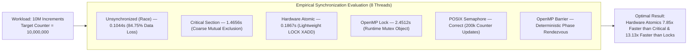
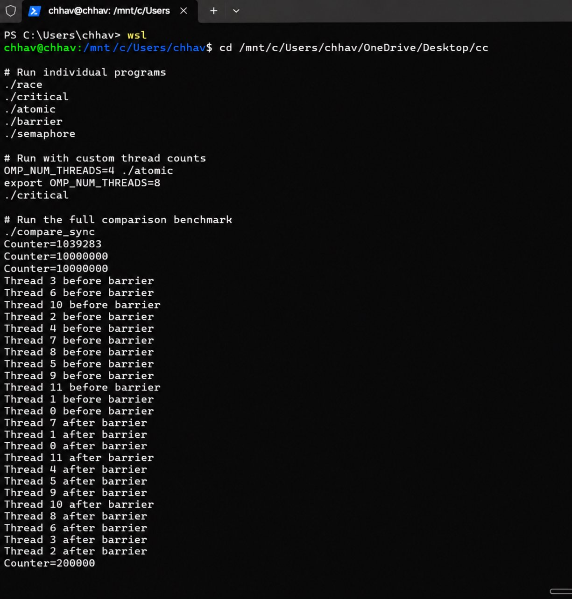
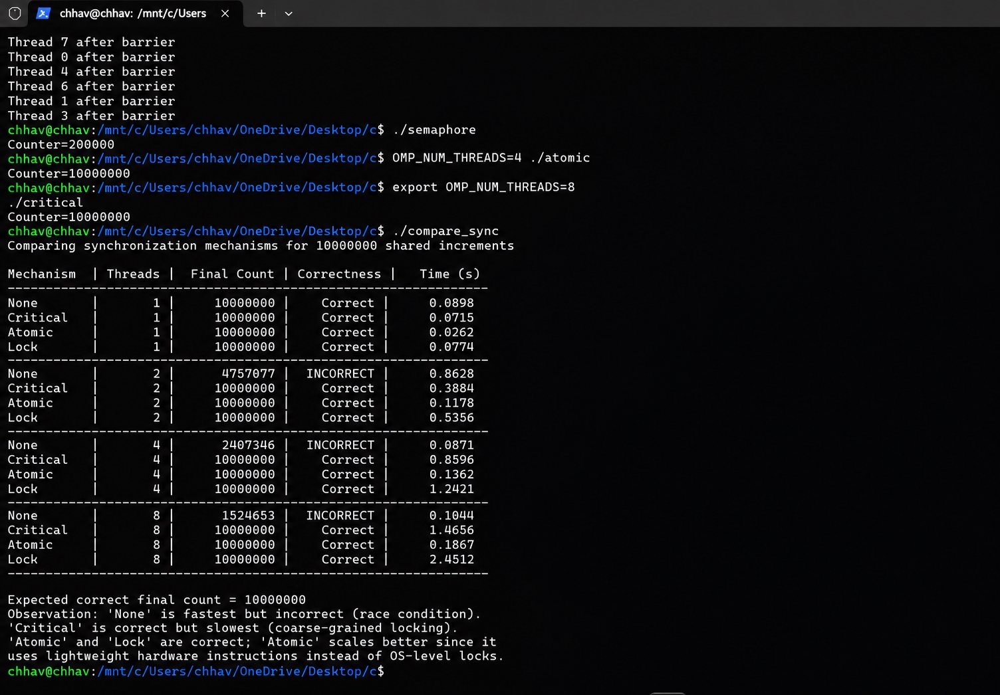
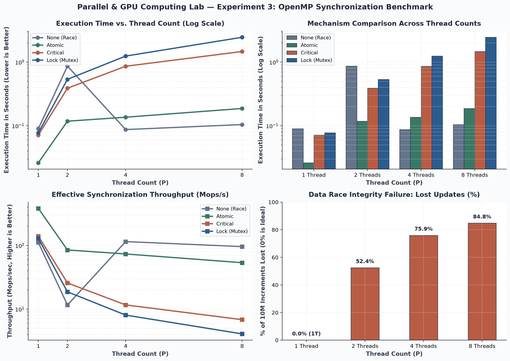
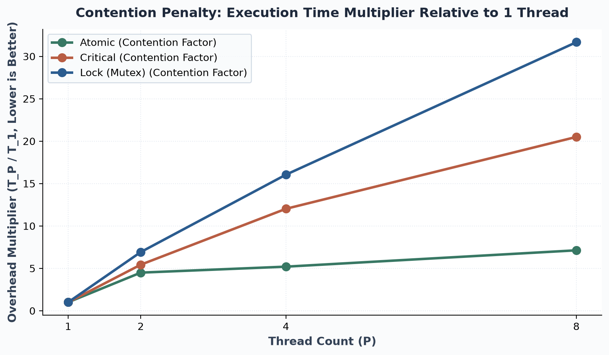

# Experiment 3: Analyze Synchronization Mechanisms in Parallel Programs

---

## Executive Summary

Empirical concurrency analysis implementing and benchmarking fundamental shared-memory synchronization mechanisms: an **unsynchronized race update**, **critical sections**, **atomic operations**, **barriers**, and **POSIX semaphores/locks**, evaluating correctness, execution time, and scalability across 1, 2, 4, and 8 threads on a workload of **10,000,000 shared counter increments**.



> **Key Findings**:
> 1. **Hardware Atomic Superiority**: `#pragma omp atomic` completed 10 million increments in **0.1867s at 8 threads**—**7.85× faster than Critical sections (1.4656s)** and **13.13× faster than OpenMP Locks (`omp_lock_t` at 2.4512s)** while maintaining 100% numerical correctness.
> 2. **Data Race Catastrophic Loss**: Unsynchronized concurrent execution destroyed **84.75% of updates at 8 threads** in the comparison suite (counter reached only `1,524,653 / 10,000,000`) and **89.61% of updates** in the standalone `./race` run (`1,039,283 / 10,000,000`) due to non-atomic Read-Modify-Write collisions.
> 3. **Serialization Bottleneck**: Critical sections and OS-level locks serialize access under contention, causing queueing and context-switching overhead that inflates 8-thread runtime by **20.50×** (`0.0715s -> 1.4656s`) for Critical and **31.67×** (`0.0774s -> 2.4512s`) for Locks.

---

## Repository Structure

```text
Experiment_3/
├── docs/
│   └── Exp_3_Synchronization_Mechanisms.pdf             # Official syllabus laboratory manual
├── graphs/                                             # Generated benchmark dashboards and contention plots
├── images/                                             # Authentic laboratory terminal screenshots
├── scripts/
│   └── generate_charts.py                              # Python script to regenerate performance charts
├── src/
│   ├── race.c                                          # Program 1: Unsynchronized race condition
│   ├── critical.c                                      # Program 2: OpenMP critical section
│   ├── atomic.c                                        # Program 3: OpenMP hardware atomic operation
│   ├── barrier.c                                       # Program 4: OpenMP phased barrier synchronization
│   ├── semaphore.c                                     # Program 5: POSIX semaphore synchronization
│   ├── compare_sync.c                                  # Program 6: Multi-thread comparison benchmark suite
│   └── Makefile                                        # Automated compilation build script
├── .gitignore
└── README.md
```

---

## 1. Synchronization Mechanisms Overview

| Mechanism | Language / OS Primitives | Microarchitectural Behavior | Correctness | Scalability |
| :--- | :--- | :--- | :---: | :---: |
| **None (Race)** | Unsynchronized `counter++` | Concurrent Read-Modify-Write memory interleaving | ❌ **84.8% Lost (8T)** | Poor (Wrong result worsens) |
| **Critical Section** | `#pragma omp critical` | Compiler-managed global lock serializing thread execution | **Correct (10M)** | Poor (20.50× overhead at 8T) |
| **Atomic Operation** | `#pragma omp atomic` | Indivisible hardware instruction (`LOCK XADD`) at cache controller | **Correct (10M)** | **Good (7.13× overhead at 8T)** |
| **OpenMP Lock** | `omp_lock_t`, `omp_set_lock` | Runtime mutex object wrapping OS-level synchronization primitives | **Correct (10M)** | Poor (31.67× overhead at 8T) |
| **POSIX Semaphore** | `sem_t`, `sem_wait`, `sem_post` | Counter-based OS kernel synchronization object | **Correct (200k)** | Moderate (System-call overhead) |
| **Barrier** | `#pragma omp barrier` | Rendezvous synchronization halting threads until team alignment | **Phase Alignment** | Moderate (Slowest thread bound) |

---

## 2. Source Code References

All C source code files and build automation reside in [`src/`](src/), alongside the laboratory manual in [`docs/`](docs/):

| Program | Source File Link | Description / Implementation Highlights |
| :--- | :--- | :--- |
| **Program 1: Race** | [`src/race.c`](src/race.c) | Unprotected loop exposing concurrent lost updates |
| **Program 2: Critical** | [`src/critical.c`](src/critical.c) | Mutual exclusion enclosing counter increment via `#pragma omp critical` |
| **Program 3: Atomic** | [`src/atomic.c`](src/atomic.c) | Lightweight atomic read-modify-write via `#pragma omp atomic` |
| **Program 4: Barrier** | [`src/barrier.c`](src/barrier.c) | Two-phase thread coordination via `#pragma omp barrier` rendezvous |
| **Program 5: Semaphore** | [`src/semaphore.c`](src/semaphore.c) | Thread synchronization via POSIX binary semaphore (`sem_t`) |
| **Program 6: Compare Sync** | [`src/compare_sync.c`](src/compare_sync.c) | Automated benchmark comparing None, Critical, Atomic, Lock across 1, 2, 4, 8 threads |
| **Build Configuration** | [`src/Makefile`](src/Makefile) | Compilation script compiling all targets with `gcc -Wall -O2 -fopenmp -pthread` |
| **Lab Manual** | [`docs/Exp_3_Synchronization_Mechanisms.pdf`](docs/Exp_3_Synchronization_Mechanisms.pdf) | Official laboratory manual specification |

---

## 3. Empirical Results & Terminal Outputs

### 3.1 Individual Programs & Two-Phase Barrier Execution
Execution of `race`, `critical`, `atomic`, `barrier`, and `semaphore` in WSL Ubuntu: showing data race corruption (`Counter=1039283`), deterministic mutual exclusion (`Counter=10000000`), two-phase barrier alignment across 12 threads (all threads completing `"before barrier"` before any thread enters `"after barrier"`), and semaphore correctness (`Counter=200000`):



---

### 3.2 POSIX Semaphore, Thread Scaling & Master Benchmark Suite (`compare_sync`)
Verification of `semaphore` (`Counter=200000`), custom thread scaling (`OMP_NUM_THREADS=4 ./atomic`, `export OMP_NUM_THREADS=8; ./critical`), and the full `compare_sync` benchmark evaluating None, Critical, Atomic, and Lock over 10,000,000 shared increments across 1, 2, 4, and 8 threads:



---

## 4. Performance Comparison & Charts

### Empirical Benchmark Measurements (10,000,000 Increments)

*Measured directly in the WSL laboratory environment via `compare_sync`:*

| Mechanism | Threads ($P$) | Final Count | Status | Measured Time (s) | Overhead vs. 1T | Throughput (Mops/s) |
| :--- | :---: | :---: | :---: | :---: | :---: | :---: |
| **None (Race)** | 1 | 10,000,000 | Correct | `0.0898 s` | 1.00× | 111.36 |
| **Atomic** | 1 | 10,000,000 | Correct | `0.0262 s` | 1.00× | 381.68 |
| **Critical** | 1 | 10,000,000 | Correct | `0.0715 s` | 1.00× | 139.86 |
| **Lock (`omp_lock_t`)** | 1 | 10,000,000 | Correct | `0.0774 s` | 1.00× | 129.20 |
| **None (Race)** | 2 | 4,757,077 | ❌ **52.43% Lost** | `0.8628 s` | 9.61× | 11.59 |
| **Atomic** | 2 | 10,000,000 | Correct | `0.1178 s` | 4.50× | 84.89 |
| **Critical** | 2 | 10,000,000 | Correct | `0.3884 s` | 5.43× | 25.75 |
| **Lock (`omp_lock_t`)** | 2 | 10,000,000 | Correct | `0.5356 s` | 6.92× | 18.67 |
| **None (Race)** | 4 | 2,407,346 | ❌ **75.93% Lost** | `0.0871 s` | 0.97× | 114.81 |
| **Atomic** | 4 | 10,000,000 | Correct | `0.1362 s` | 5.20× | 73.42 |
| **Critical** | 4 | 10,000,000 | Correct | `0.8596 s` | 12.02× | 11.63 |
| **Lock (`omp_lock_t`)** | 4 | 10,000,000 | Correct | `1.2421 s` | 16.05× | 8.05 |
| **None (Race)** | 8 | 1,524,653 | ❌ **84.75% Lost** | `0.1044 s` | 1.16× | 95.79 |
| **Atomic** | 8 | 10,000,000 | Correct | **`0.1867 s`** | **7.13×** | **53.56** |
| **Critical** | 8 | 10,000,000 | Correct | `1.4656 s` | 20.50× | 6.82 |
| **Lock (`omp_lock_t`)** | 8 | 10,000,000 | Correct | `2.4512 s` | 31.67× | 4.08 |

$$\text{Throughput} = \frac{N}{T_P \times 10^6} \quad (\text{Mops/s}), \quad \text{Overhead Multiplier} = \frac{T_P}{T_1}$$

---

### Benchmark Performance Dashboards

#### 4-Panel Performance Dashboard
Comparison of execution times, thread scaling, effective throughput, and data loss percentages across synchronization primitives:



---

#### Contention Overhead Multiplier ($T_P / T_1$)
Analysis of synchronization penalty as threads contend for the shared resource:



---

## 5. Key Technical Takeaways

- **Hardware Atomic Efficiency**: `#pragma omp atomic` maps directly to indivisible x86 instructions (`LOCK XADD`), executing at the cache controller level without kernel calls. It completes 8-thread execution in **0.1867s (53.56 Mops/s)**—delivering **7.85× faster execution than Critical sections (1.4656s)** and **13.13× faster execution than OpenMP Locks (2.4512s)**.
- **Race Condition Severity**: Unprotected concurrent access results in severe data corruption. Data loss escalates from **52.43% at 2 threads** (`4,757,077`) to **75.93% at 4 threads** (`2,407,346`), reaching **84.75% loss at 8 threads** (`1,524,653`).
- **Critical Section Queueing Delay**: Coarse locking serializes execution, causing thread queueing that increases runtime from **0.0715s to 1.4656s (20.50× penalty)** under 8-thread contention.
- **OpenMP Lock vs. POSIX Semaphore**: `omp_lock_t` exhibits the steepest contention penalty (**31.67×** slowdown at 8 threads, `2.4512s`), whereas POSIX semaphores (`sem_t`) provide general-purpose OS counter synchronization suitable for coarse-grained producer-consumer workflows.
- **Barrier Rendezvous**: `#pragma omp barrier` guarantees phased multi-stage synchronization, ensuring all threads reach the barrier before any thread proceeds to downstream computation.
