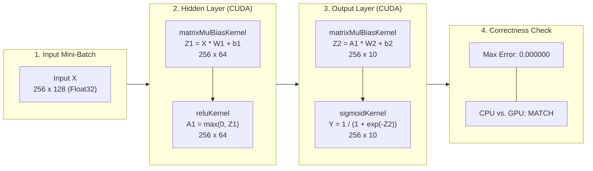
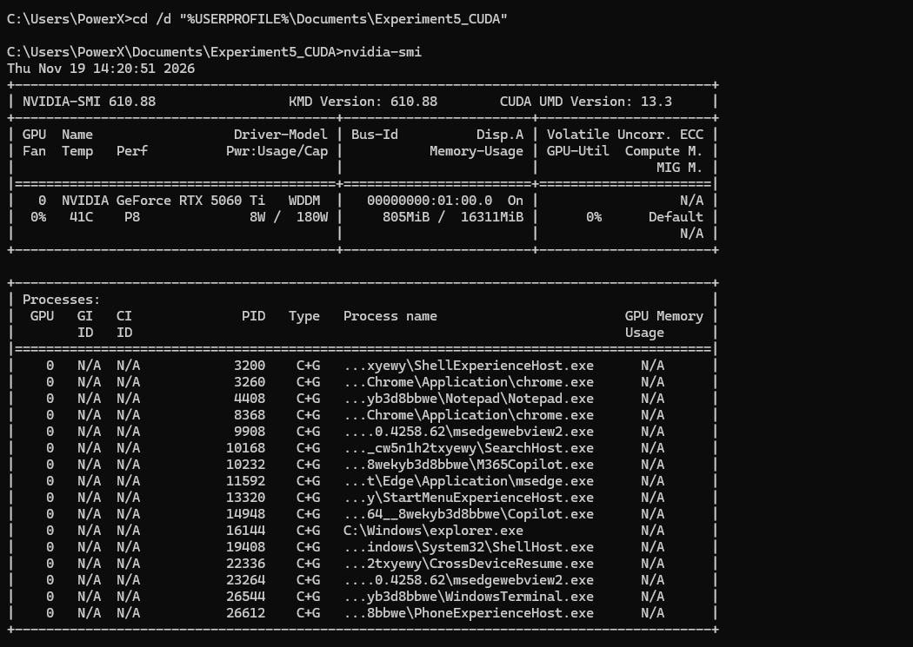
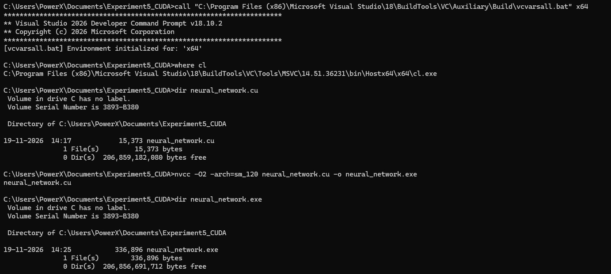
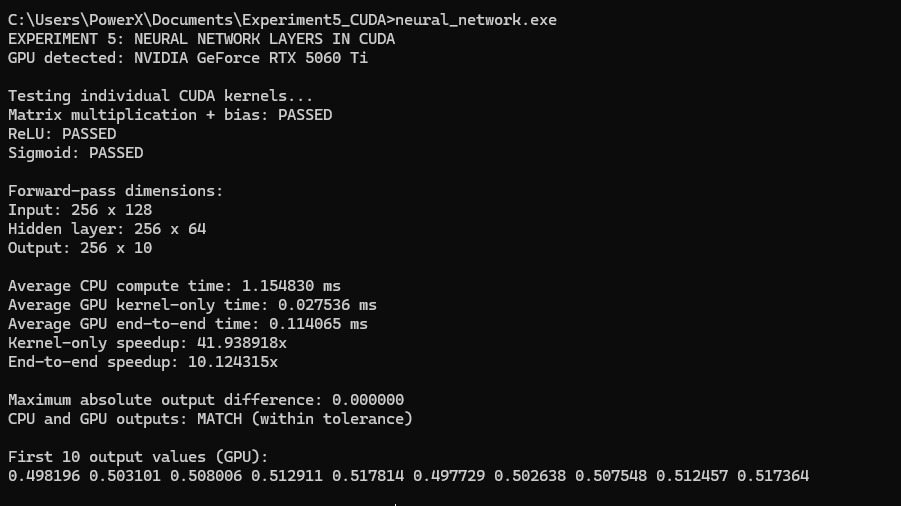
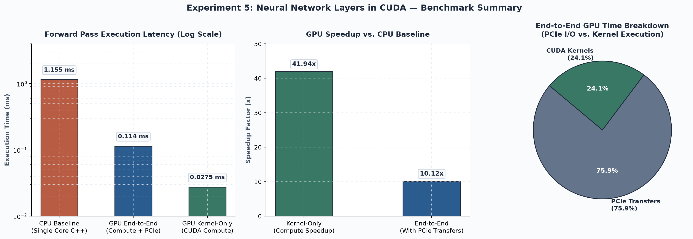
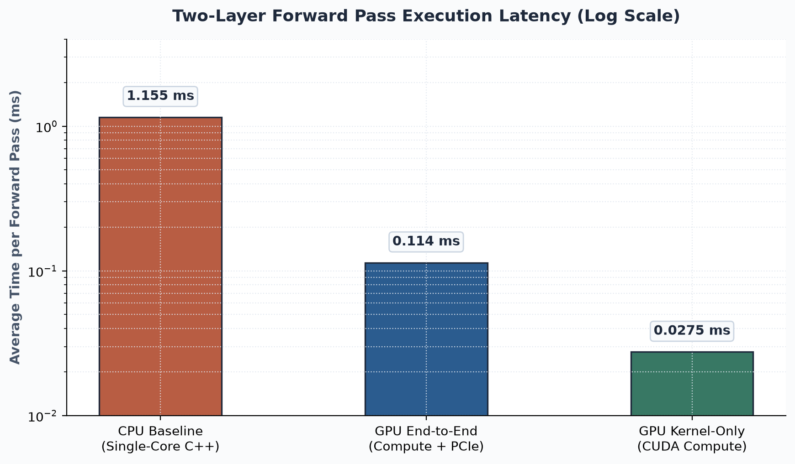
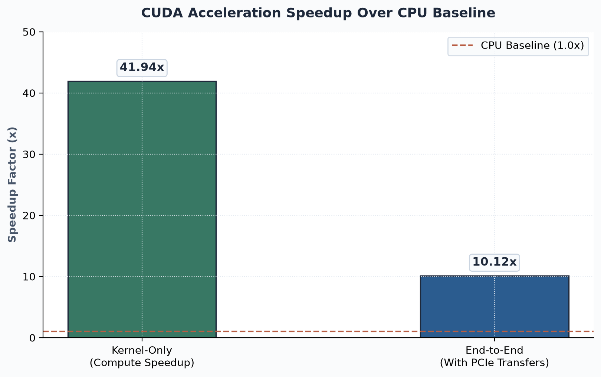

# Experiment 5: Neural Network Layers in CUDA

---

## Executive Summary

This experiment implements and benchmarks custom **CUDA C++ kernels for feed-forward neural network inference** from scratch without relying on external deep learning libraries: **Dense Matrix Multiplication with Bias (`matrixMulBiasKernel`)**, **ReLU Activation (`reluKernel`)**, and **Sigmoid Activation (`sigmoidKernel`)**.

A two-layer neural network ($256 \times 128 \rightarrow 64 \rightarrow 10$) is evaluated across 20 timed passes on both a **single-threaded CPU C++ baseline** and an **NVIDIA GeForce RTX 5060 Ti** GPU. Both **kernel-only** compute latency (via `cudaEvent_t`) and **end-to-end** wall-clock latency (including PCIe host-to-device and device-to-host memory copies via `std::chrono`) are measured alongside strict numerical verification against CPU outputs.



> ### Key Results
> - **41.94× Kernel-Only Speedup**: GPU compute kernels complete the two-layer forward pass in **`0.027536 ms`**, down from **`1.154830 ms`** on the single-core CPU reference.
> - **10.12× End-to-End Speedup**: Including full PCIe `cudaMemcpy` transfers (`0.086529 ms` overhead), total GPU inference latency averages **`0.114065 ms`**.
> - **Data Transfer Dominates Small Batches**: PCIe transfers account for **75.86%** of end-to-end GPU latency, illustrating why keeping weights resident in device VRAM is essential in production inference.
> - **Exact Numerical Consistency**: All three standalone unit tests passed and full-network GPU outputs matched the CPU baseline with **`0.000000`** maximum absolute difference.

---

## Table of Contents

1. [Experiment Objectives](#1-experiment-objectives)
2. [Kernel Design & Mathematical Model](#2-kernel-design--mathematical-model)
3. [Network Dimensions & Tensor Layout](#3-network-dimensions--tensor-layout)
4. [Source Files & Structure](#4-source-files--structure)
5. [Build, Execution & Screenshots](#5-build-execution--screenshots)
6. [Benchmark Results & Charts](#6-benchmark-results--charts)
7. [Technical Discussion](#7-technical-discussion)
8. [Viva-Voce Review Questions](#8-viva-voce-review-questions)
9. [Conclusions](#9-conclusions)

---

## 1. Experiment Objectives

1. **Custom CUDA Layer Kernels**: Write GPU kernels from scratch for linear projection + bias (`matrixMulBiasKernel`), ReLU (`reluKernel`), and Sigmoid (`sigmoidKernel`).
2. **Thread Hierarchy Mapping**: Use 2D thread blocks (`16 x 16 = 256` threads) with boundary checks for matrix multiplication and 1D blocks (`256` threads) for element-wise activations.
3. **Kernel vs. End-to-End Profiling**: Separate pure GPU kernel time (`cudaEvent_t`) from full host-device transfer + compute time (`std::chrono::steady_clock`).
4. **Analytical Verification**: Validate each kernel with standalone unit tests before benchmarking the complete two-layer forward pass against a deterministic CPU reference.

---

## 2. Kernel Design & Mathematical Model

### 2.1 Dense Matrix Multiplication + Bias (`matrixMulBiasKernel`)
For input $A \in \mathbb{R}^{M \times K}$, weight matrix $B \in \mathbb{R}^{K \times N}$, and bias $\mathbf{b} \in \mathbb{R}^{N}$, each thread computes one entry $C_{ij}$:

$$C_{ij} = \left(\sum_{k=0}^{K-1} A_{ik} B_{kj}\right) + b_j$$

Using row-major indexing (`A[row * K + k]`, `B[k * N + col]`, `C[row * N + col]`) with global indices:
$$\text{row} = \text{blockIdx.y} \cdot \text{blockDim.y} + \text{threadIdx.y}, \quad \text{col} = \text{blockIdx.x} \cdot \text{blockDim.x} + \text{threadIdx.x}$$

```cuda
__global__ void matrixMulBiasKernel(const float* A, const float* B, const float* bias, float* C, int M, int N, int K) {
    int row = blockIdx.y * blockDim.y + threadIdx.y;
    int col = blockIdx.x * blockDim.x + threadIdx.x;
    if (row < M && col < N) {
        float sum = 0.0f;
        for (int k = 0; k < K; ++k) {
            sum += A[row * K + k] * B[k * N + col];
        }
        C[row * N + col] = sum + bias[col];
    }
}
```

### 2.2 ReLU Activation (`reluKernel`)
Applies $\text{ReLU}(x) = \max(0, x)$ in-place across a 1D grid using `fmaxf()`:

```cuda
__global__ void reluKernel(float* values, int count) {
    int idx = blockIdx.x * blockDim.x + threadIdx.x;
    if (idx < count) {
        values[idx] = fmaxf(0.0f, values[idx]);
    }
}
```

### 2.3 Sigmoid Activation (`sigmoidKernel`)
Applies $\sigma(x) = \frac{1}{1 + e^{-x}}$ in-place across a 1D grid using `expf()`:

```cuda
__global__ void sigmoidKernel(float* values, int count) {
    int idx = blockIdx.x * blockDim.x + threadIdx.x;
    if (idx < count) {
        values[idx] = 1.0f / (1.0f + expf(-values[idx]));
    }
}
```

---

## 3. Network Dimensions & Tensor Layout

| Tensor | Symbol | Shape | Elements | Size (Float32) | Role |
| :--- | :---: | :---: | :---: | :---: | :--- |
| **Input Batch** | $X$ | $256 \times 128$ | $32,768$ | $128\text{ KB}$ | Mini-batch feature matrix |
| **Layer 1 Weights** | $W_1$ | $128 \times 64$ | $8,192$ | $32\text{ KB}$ | Input-to-hidden weights |
| **Layer 1 Bias** | $b_1$ | $64$ | $64$ | $256\text{ B}$ | Hidden layer bias |
| **Hidden Output** | $Z_1, A_1$ | $256 \times 64$ | $16,384$ | $64\text{ KB}$ | Pre/post-ReLU activations |
| **Layer 2 Weights** | $W_2$ | $64 \times 10$ | $640$ | $2.5\text{ KB}$ | Hidden-to-output weights |
| **Layer 2 Bias** | $b_2$ | $10$ | $10$ | $40\text{ B}$ | Output layer bias |
| **Final Output** | $Z_2, Y$ | $256 \times 10$ | $2,560$ | $10\text{ KB}$ | Sigmoid output probabilities |

Deterministic initialization ensures identical inputs and weights across CPU and GPU runs:
- $X[i] = 0.5 \sin(0.013i)$, $W_1[i] = 0.08 \cos(0.017i)$, $b_1[i] = 0.01(i \bmod 7)$, $W_2[i] = 0.10 \sin(0.019i)$, $b_2[i] = 0.02(i \bmod 5)$.

---

## 4. Source Files & Structure

```text
Experiment_5/
├── docs/
│   └── Exp_5_Neural_Network_Layers_in_CUDA.pdf
├── images/
│   ├── 01_nvidia_smi_environment.jpg
│   ├── 02_vcvarsall_and_nvcc_compilation.jpg
│   ├── 03_neural_network_execution_output.jpg
│   ├── performance_comparison_dashboard.png
│   ├── execution_time_comparison.png
│   └── speedup_analysis.png
├── scripts/
│   └── generate_charts.py
├── src/
│   ├── Makefile
│   └── neural_network.cu
├── .gitignore
└── README.md
```

| File | Link | Description |
| :--- | :--- | :--- |
| **CUDA Source** | [`src/neural_network.cu`](src/neural_network.cu) | Custom CUDA kernels, unit tests, CPU reference, and dual timing loop |
| **Build File** | [`src/Makefile`](src/Makefile) | Builds `neural_network` with `nvcc -O2 -arch=sm_120` |
| **Chart Script** | [`scripts/generate_charts.py`](scripts/generate_charts.py) | Generates latency, speedup, and PCIe breakdown charts |
| **Lab Manual** | [`docs/Exp_5_Neural_Network_Layers_in_CUDA.pdf`](docs/Exp_5_Neural_Network_Layers_in_CUDA.pdf) | Official laboratory specification |

---

## 5. Build, Execution & Screenshots

### 5.1 GPU Device & Driver Verification (`nvidia-smi`)
Confirmed **NVIDIA GeForce RTX 5060 Ti** (`16,311 MiB` VRAM), Driver Version `610.88`, and CUDA UMD Version `13.3`:



---

### 5.2 MSVC x64 Setup & `nvcc` Compilation
Initialized the Visual Studio 2026 x64 Developer environment (`vcvarsall.bat x64`), verified `cl.exe`, and compiled with `nvcc -O2 -arch=sm_120 neural_network.cu -o neural_network.exe`:



---

### 5.3 Execution Output, Unit Tests & Speedup Verification
Execution of `neural_network.exe` passing all three kernel unit tests (`PASSED`), reporting CPU vs. GPU timings across 20 repeats, and matching outputs with `0.000000` maximum absolute error:



---

## 6. Benchmark Results & Charts

### 6.1 Summary Metrics

| Metric | CPU Reference (C++) | GPU Kernel-Only (`cudaEvent_t`) | GPU End-to-End (PCIe + Compute) | Notes |
| :--- | :---: | :---: | :---: | :--- |
| **Average Latency** | `1.154830 ms` | `0.027536 ms` | `0.114065 ms` | Averaged over 20 passes |
| **Speedup vs. CPU** | `1.000000×` | **`41.938918×`** | **`10.124315×`** | 41.94× compute / 10.12× E2E |
| **PCIe Transfer Share** | — | — | `0.086529 ms` (**75.86%**) | $T_{\text{E2E}} - T_{\text{Kernel}}$ |
| **Max Absolute Error** | `0.000000` | `0.000000` | `0.000000` | Exact match within `1e-4` |
| **Unit Tests** | — | **3 / 3 PASSED** | **3 / 3 PASSED** | MatMul+Bias, ReLU, Sigmoid |

### 6.2 Visual Analysis



| Execution Latency (Log Scale) | Acceleration Speedup Factor |
| :---: | :---: |
|  |  |

---

## 7. Technical Discussion

1. **Parallel Matrix Compute Scaling (41.94×)**:
   Layer 1 performs $256 \times 64 \times 128 = 2,097,152$ multiply-accumulate operations and Layer 2 performs $256 \times 10 \times 64 = 163,840$ operations. While the CPU evaluates these sequentially in nested loops (`1.154830 ms`), CUDA launches `4 x 16 = 64` blocks ($256$ threads/block) for Layer 1 and `1 x 16 = 16` blocks for Layer 2, computing all output elements concurrently in `0.027536 ms`.
2. **PCIe Overhead in Small-Batch Inference**:
   Copying $X, W_1, b_1, W_2, b_2$ to device memory and reading $Y$ back takes `0.086529 ms` (`75.86%` of the `0.114065 ms` end-to-end runtime), reducing speedup from `41.94×` to `10.12×`. Keeping model weights resident on the GPU and increasing batch size amortizes this PCIe cost.
3. **Implicit Stream Serialization**:
   Because all four kernel launches (`matrixMulBiasKernel` $\rightarrow$ `reluKernel` $\rightarrow$ `matrixMulBiasKernel` $\rightarrow$ `sigmoidKernel`) execute on the default CUDA stream, the GPU guarantees sequential stage completion without explicit host-side synchronization between layers.

---

## 8. Viva-Voce Review Questions

1. **What is a CUDA kernel?** A `__global__` function launched from the host and executed in parallel across thousands of GPU threads arranged in blocks and grids.
2. **Why is a boundary check needed in CUDA kernels?** Grid dimensions round up to multiples of the block size (e.g., $16 \times 16$); `if (row < M && col < N)` prevents out-of-bounds memory accesses by extra threads.
3. **Why use `cudaEvent_t` for kernel timing?** Kernel launches are asynchronous; `cudaEvent_t` records hardware timestamps directly on the GPU stream for accurate kernel-only timing.
4. **Why does end-to-end speedup (10.12×) differ from kernel-only speedup (41.94×)?** End-to-end time includes host-to-device and device-to-host `cudaMemcpy` transfers over PCIe, which have much higher latency than GPU VRAM compute.
5. **Why warm up the GPU before timing?** The first CUDA launch incurs one-time context initialization and clock-ramp overhead; a warm-up pass ensures steady-state measurements.

---

## 9. Conclusions

- Custom CUDA kernels achieved a **41.94× compute speedup** and **10.12× end-to-end speedup** for a two-layer neural network forward pass on an NVIDIA RTX 5060 Ti.
- Numerical verification confirmed **`0.000000`** maximum output difference relative to the C++ CPU reference, with all unit tests passing.
- For small-batch workloads ($256 \times 128$), PCIe data transfer consumes **75.86%** of end-to-end GPU time, highlighting the importance of persistent GPU weight residency.
